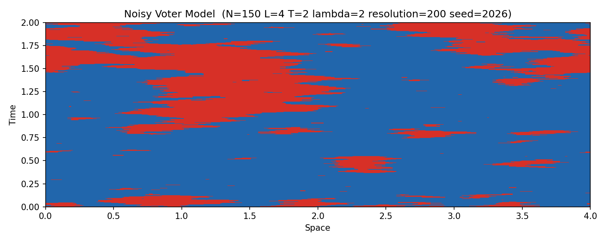

Page's link: [The noisy voter model](https://alessandrogubbiotti.github.io/Glauber/voter.html), in the pages of the [Glauber dynamics](https://github.com/alessandrogubbiotti/Glauber)

# Continuum Noisy Voter Model

This repository simulates the **noisy voter model** on a ring, in discrete time: at each step a site takes the colour of one of its two neighbours, or a new colour if it is marked. Under a diffusive rescaling the random walks of the voter model become the Brownian web, and the model is the **Continuum Noisy Voter Model** of [Fontes, Isopi, Newman and Ravishankar](https://arxiv.org/abs/math/0404505). The convergence of the random walks to the Brownian web is in [The Brownian web: characterization and convergence](https://arxiv.org/abs/math/0311254), of the same authors. For the perturbations of the voter model in discrete time, see [Perturbations of the voter model in one dimension](https://arxiv.org/abs/1607.06058), of Newman, Ravishankar and Schertzer.

---

## State Space

We consider the ring of length $L$, with sites spaced by $1/N$. Every site has one of two colours, $0$ or $1$.

---

## Dynamics

Time is discrete. At each step every site, independently of the others,

- **is marked** with probability $\lambda/N^2$: it takes a new colour, $0$ or $1$ with probability $1/2$;
- otherwise **takes the colour** that one of its two neighbours, the left or the right one with probability $1/2$, had at the step before.

At time $0$ all the sites are marked, so the colours are independent.

---

## Genealogies

The colour of a site is found by following its **genealogy** backwards in time: a random walk that at each step goes to the left or to the right, until the first mark is met. The genealogies of two sites are independent until they meet, and then they are the same: they are **coalescing random walks**, marked with a geometric clock of parameter $\lambda/N^2$.

A genealogy moves by one site at each step, so along it the parity of $x + k$, the site plus the step, is constant. The points with $x + k$ even and the ones with $x + k$ odd never meet, and they carry two independent copies of the model. The program simulates one of them: a row has $NL/2$ sites, spaced by $2/N$.

---

## Scaling Limit

A unit of time is $N^2$ steps. As $N \to \infty$ the genealogies converge to coalescing Brownian motions, the **Brownian web**, and the marks to a Poisson process of rate $\lambda$ along them. The colour of a point is the one of the first mark met by its path.

In the limit, at a large time, on the line:

- **Correlation** The correlation of the colours of two points at distance $d$ is $e^{-\sqrt{2\lambda} d}$.
- **Interfaces** The interfaces between the two colours have density $\sqrt{\lambda/2}$.

On the ring of length $L$ the density of the interfaces is $\sqrt{\lambda/2}\tanh(L\sqrt{\lambda/2})$: it is the one of the line when the ring is long with respect to $1/\sqrt{2\lambda}$.

---

## The Glauber Dynamics

Read as a two-colour voter model, the Glauber dynamics of the Ising chain is a noisy voter model in continuous time. With $\nu$ the intensity of its interfaces, $\tau$ its macroscopic time, in which an isolated interface has variance $2$ in a unit of time, and $t$ the time of this program, in which it has variance $1$, the two models have the same limit for

```math
\lambda = 2\nu^2, \qquad t = 2\tau.
```

This repository is a submodule of [Glauber](https://github.com/alessandrogubbiotti/Glauber), where `python_scripts/plot_voter_comparison.py` draws the two dynamics side by side.

---

## The Program

The GSL is needed, and `numpy` and `matplotlib` for the picture.

```bash
cc nvm_sim.c -o nvm_sim -lgsl -lgslcblas -lm
./nvm_sim              # writes output.txt and output.pgm
python3 plot.py        # writes output.png
```

The parameters are the `#define` at the top of `nvm_sim.c`:

- **`N`** The sites in a unit of length. The default is `300`.
- **`L`** The length of the ring, an integer. The default is `1`.
- **`T`** The final time. The default is `2`. The run ends at the last saved time not after `T`: with `T` smaller than `1/RESOLUTION` no step is made.
- **`LAMBDA`** The rate of the marks. The default is `1.0`.
- **`RESOLUTION`** The saved rows in a unit of time. The default is `100`.
- **`SEED`** The seed of the random numbers. With `0`, the default, it is taken from the clock, in seconds: two runs started in the same second are the same run.

$NL$ has to be even, and `RESOLUTION` at most $N^2/2$. `T` and `LAMBDA` are real numbers, and a fraction is written with the decimal point: `0.5` and not `1/2`, which in C is `0`.

They can also be given at compile time:

```bash
cc -DN=150 -DL=4 -DT=2 -DLAMBDA=2 -DRESOLUTION=200 -DSEED=2026 nvm_sim.c -o nvm_sim -lgsl -lgslcblas -lm
```

The program writes

- **`output.txt`** A first line with the parameters, and then one line for each saved time, from the time $0$: the colours of the sites of the row.
- **`output.pgm`** The same as a picture, with the time going upwards.

It prints the density of the interfaces, averaged over the second half of the run, next to its limit on the ring and on the line. With the default parameters the ring has less than one interface on average, so the density of one run can be far from the limit. The check below uses a long ring.

---

## The Check

On the lattice of the program, at a large time and on a long ring, the correlation of the colours of two sites of a row at the distance of $j$ sites is $r^j$, where

```math
r = \frac{(2-s)-2\sqrt{1-s}}{s}, \qquad s = \Big(1-\frac{\lambda}{N^2}\Big)^2,
```

and the density of the interfaces is $N(1-r)/4$. On a ring with $n = NL/2$ sites in a row the correlation is $(r^j + r^{n-j})/(1 + r^n)$ and the density is $N(1-r)(1-r^{n-1})/(4(1+r^n))$.

- **Density** With $N = 100$, $L = 200$ and $\lambda = 2$, up to the time $6$, ten runs give $0.985 \pm 0.007$. On the lattice it is $0.980$, and in the limit $1$. The seed is given at compile time, so the program is compiled once for each seed, from $1$ to $10$.

```bash
for s in 1 2 3 4 5 6 7 8 9 10; do
    cc -DN=100 -DL=200 -DT=6 -DLAMBDA=2 -DSEED=$s nvm_sim.c -o nvm_sim -lgsl -lgslcblas -lm
    ./nvm_sim
done
```

---

## Figures

- **The noisy voter model** with $N = 150$, $L = 4$ and $\lambda = 2$, up to the time $2$. It is `output.png` for the second `cc` command above, the one with the seed $2026$.
  
